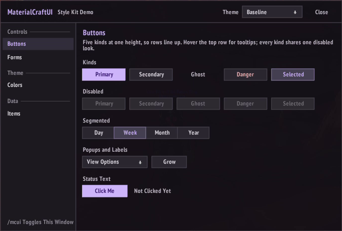
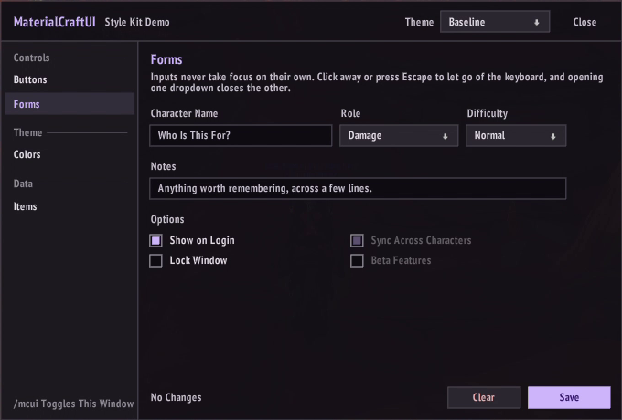
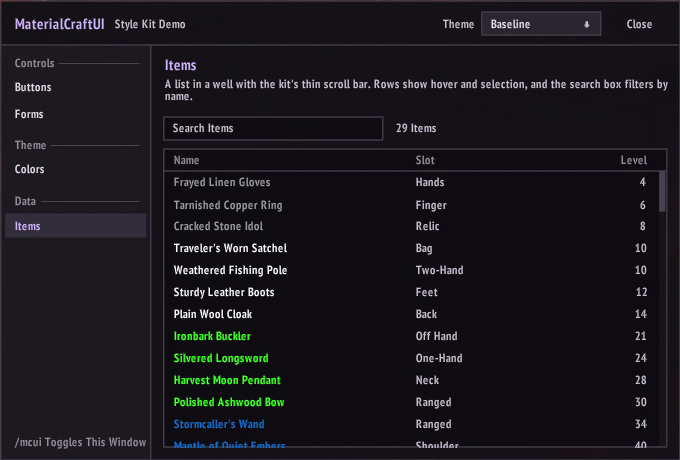
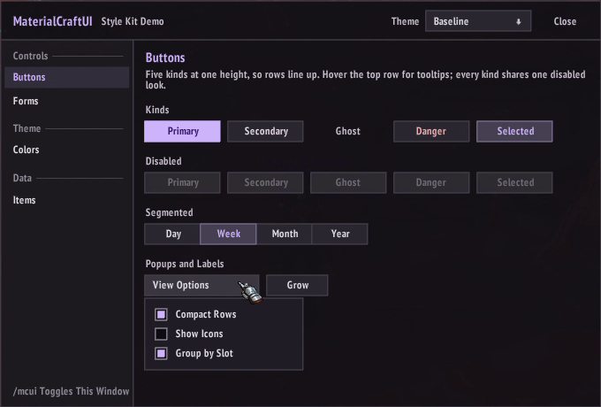
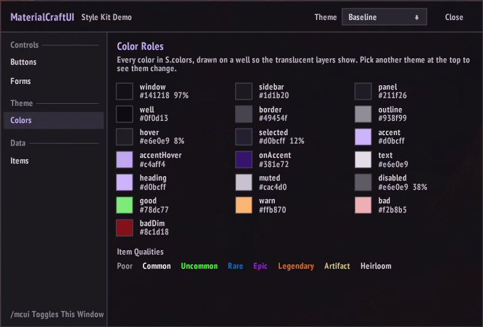
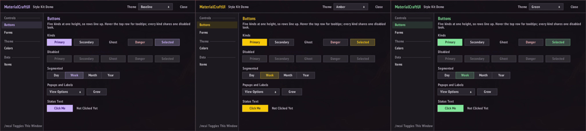

# MaterialCraftUI

A flat dark style kit for World of Warcraft 3.3.5a (Wrath of the Lich King) addons, built on
[Material 3](https://m3.material.io/) color roles. It gives you surfaces, one accent color, 1px borders, hover
and press states, and Material's filled, tonal and text buttons.

It's a single file, `Style.lua`, with no dependencies. Each addon ships its own copy, and nothing is shared at
runtime, so two addons using different versions never affect each other.



| Forms | Items |
| --- | --- |
|  |  |
| **Popups** | **Color Roles** |
|  |  |

## Features

- **Color Roles:** window, panel and well surfaces, borders, an accent, text, and good, warning and bad colors.
- **Themes:** swap in your own accent or a whole Material 3 scheme with one call.
- **Skins:** change how the controls are drawn, not just their colors. The flat Material skin is built in, and the
  optional Classic (the default UI's own look) and painted Cognac skins come in their own folders.
- **Controls:** buttons in five kinds, checkboxes, dropdowns, and one-line or multi-line inputs with placeholders.
- **Dropdown Behavior:** menus and popups close on a click anywhere else, and inputs give up the keyboard the same
  way. Nothing grabs focus on its own.
- **Fonts Without Shadows:** text uses the client's own fonts, read again when UI addons such as ElvUI restyle them.
- **No Name Clashes:** font objects are named after the addon that loads the kit.

## Requirements

- WoW 3.3.5a (Interface 30300), which runs Lua 5.1.
- To run the tests: Python 3 and [lupa](https://pypi.org/project/lupa/).

## Adding It to an Addon

1. Copy `Style.lua` into your addon, for example as `UI/Style.lua`.
2. List it in your `.toc` before any file that uses it:

   ```
   UI\Style.lua
   UI\MyWindow.lua
   ```

3. Read it from the addon table in your own files:

   ```lua
   local _, NS = ...
   local S = NS.Style
   ```

### Keeping the Copy Up to Date

`tools/sync_style.py` copies `Style.lua` into an addon and stamps its first line with the version it came from,
such as `v1.0.0`, or the tag plus the commits since it (`v1.0.0-2-gabc1234`), so you can always tell which version
an addon ships:

```bash
py -I -X utf8 tools/sync_style.py "<addon repo>" "<addon folder>"
```

It writes `<addon repo>/<addon folder>/UI/Style.lua`. Name skins after the folder to copy them too, such as
`Cognac`; each goes to `UI/Skins/<Skin>`. A small wrapper in the addon's own `tools/` folder makes
this one command. This one assumes MaterialCraftUI is checked out next to the addon's repo, and the
`MATERIALCRAFTUI` environment variable can point it somewhere else:

```python
import os, runpy, sys

ROOT = os.path.dirname(os.path.dirname(os.path.abspath(__file__)))
LIB = os.environ.get('MATERIALCRAFTUI', os.path.join(ROOT, '..', 'MaterialCraftUI'))
sys.argv = [sys.argv[0], ROOT, 'MyAddon']
runpy.run_path(os.path.join(LIB, 'tools', 'sync_style.py'), run_name='__main__')
```

Commit the copy in your addon. Releases then need nothing from this repo.

## Example

```lua
local _, NS = ...
local S = NS.Style
local C = S.colors

local f = CreateFrame("Frame", "MyAddonWindow", UIParent)
f:SetSize(320, 160)
f:SetPoint("CENTER")
S.RefreshFonts()
S.Panel(f, C.window, C.border)

local title = S.Text(f, "large", C.heading)
title:SetPoint("TOPLEFT", S.PAD, -S.PAD)
title:SetText("My Addon")

local name = S.Input(f, "MyAddonName", 180, "Character Name")
name:SetPoint("TOPLEFT", title, "BOTTOMLEFT", 0, -S.GAP)

local mode = S.Dropdown(f, 120, function(value) print("Picked", value) end)
mode:SetOptions({ { value = 1, text = "Fast" }, { value = 2, text = "Thorough", tooltip = "Slower, checks more." } })
mode:SetText("Fast")
mode:SetPoint("LEFT", name, "RIGHT", S.GAP, 0)

local save = S.Button(f, "Save", "primary", 90, function() print(name:GetText()) end, "Save the name.")
save:SetPoint("BOTTOMRIGHT", -S.PAD, S.PAD)

f:SetScript("OnHide", S.Dismiss)
```

## Demo

`demo/MaterialCraftUIDemo` is a small addon that shows every control in one window: each button kind and its
disabled look, a segmented button, a popup, inputs, dropdowns, checkboxes, every color role and a scrolling list.
A dropdown in its title bar switches between a few themes and the Cognac and Classic skins. Copy the folder into
`Interface\AddOns` and type `/mcui` in game.

Its `UI/Style.lua` and `UI/Skins` are synced copies like any addon's. After changing the kit, refresh them with:

```bash
py -I -X utf8 tools/sync_style.py demo MaterialCraftUIDemo Cognac Classic
```

## Reference

### Colors and Spacing

`S.colors` holds `{ r, g, b, a }` tables, ready for `unpack`:

| Role | Use |
| --- | --- |
| `window`, `sidebar`, `panel`, `well` | Surfaces, from the window background down to sunken areas like inputs and lists |
| `border`, `outline` | The soft 1px border, and the stronger one for hover |
| `accent`, `accentHover`, `onAccent` | The accent fill, its hover, and text on top of it |
| `text`, `heading`, `muted`, `disabled` | Body text, headings (accent), secondary text, disabled text |
| `hover`, `selected` | Translucent layers for hovered and selected controls |
| `rowHover`, `rowSelected` | The same for table and list rows (`hover` and `selected` unless a skin sets them) |
| `navSelected` | The selected entry's label in a navigation sidebar (`heading` unless a skin sets it) |
| `arrow`, `scrollThumb`, `scrollThumbHover` | Dropdown arrows and scrollbar thumbs |
| `good`, `warn`, `bad`, `badDim` | Status colors |

Your addon can also add its own colors to `S.colors`. They stay there when the theme changes.

### Themes

The default is Material 3's baseline dark scheme, with a lavender accent on cool dark grays. `S.SetTheme` swaps in
your own colors by Material 3 role name, as `"rrggbb"` hex (with or without `#`) or `{ r, g, b }`. Roles you
leave out keep the default:

```lua
S.SetTheme({ primary = "#7cacf8" })
```



| Role | Drives |
| --- | --- |
| `primary`, `onPrimary` | The accent, headings, primary buttons and their text |
| `surfaceLowest`, `surface`, `surfaceLow`, `surfaceContainer`, `surfaceHigh` | Wells, the window, the sidebar, panels, and secondary buttons |
| `onSurface`, `onSurfaceVariant` | Body text and muted text |
| `outline`, `outlineVariant` | The hover border and the resting border |
| `error`, `errorContainer`, `success`, `warning` | `bad`, `badDim`, `good` and `warn` |

If you set `primary` without `onPrimary`, the kit works one out: a dark shade of a light accent, or a light tint
of a dark one. For a full matching scheme from one seed color, generate it with Google's
[Material Theme Builder](https://material-foundation.github.io/material-theme-builder/) and pass in its dark
scheme roles.

Call `S.SetTheme` once, before your addon builds any frames, since frames take their colors when they're made.
`S.SetTheme()` with nothing goes back to the default. Each addon has its own copy of the kit, so a theme only
changes the addon that sets it.

`S.PAD` (12) is the padding inside a panel, `S.GAP` (8) the space between controls, and `S.CONTROL_H` (24) the
height of every button, input and dropdown, so a row of controls lines up.

### Pixels

The client lays out in UI units, and one unit is `effective scale × screen height / 768` screen pixels, rarely a
whole number. So a 1px border or an edge can fall between two rows of pixels and blur, or come out a pixel off from
its neighbor. Give each top-level window, dialog and popup `S.PixelScale(frame)`: it scales the frame so one of its
units is a whole number of screen pixels, the number nearest to the UI scale, and keeps it so when the UI scale or
the screen size changes. Every whole-unit position and size inside it then lands on real pixels. At a UI scale
that's already pixel-perfect (0.71 at 1080p, say) nothing changes size; at others the window comes out a little
larger or smaller. `S.PixelScale(frame, false)` turns it off.

- `S.SnapPosition(frame)`: moves a frame's top left corner onto a whole pixel. Run it after placing a window and
  after it's dragged.
- `S.PixelSize(region)`: one screen pixel in a region's units.
- `S.Snap(region, v)`: a length rounded to whole screen pixels.

### Skins

A skin decides how buttons, inputs, window frames, sidebars, hover states and navigation entries are drawn. The
flat **Material** skin is built in and is the default. Others live in `Skins/<Name>`: a `Skin.lua`, and for a
painted skin an `Atlas.lua` and its texture. List them in your `.toc` after `Style.lua`:

```
UI\Style.lua
UI\Skins\Cognac\Atlas.lua
UI\Skins\Cognac\Skin.lua
UI\Skins\Classic\Skin.lua
```

Pick one with `S.UseSkin(key, roles)` before building any frames. A skin with a scheme of its own ignores
`roles`; Material uses them, so an addon keeps its own accent:

```lua
S.UseSkin(MyAddonDB.skin or "material", { primary = "ffc400" })
```

Frames take their look when they're made, so switching skins needs a `/reload` (or rebuilding the window).
`S.Skin()` is the skin in use, and `S.Skins()` lists `{ key, label, credit }` for a picker, Material first.

To keep layouts working in every skin, build windows with the skin-aware helpers:

- `S.Frame(frame, role)`: the frame's background and border. `role` is `"window"` for a main window, `"popup"` for
  a dialog or picker, or `"menu"` for a small list dropped from a control.
- `S.metrics.edge`: how far in from a window's edges its content has to start (0 for Material, 18 for Cognac).
  Grow the window by twice this, so its content keeps the same size. `S.metrics.inset` is the padding inside a
  popup, `S.metrics.navInset` how far in from a sidebar's sides its entries sit, `S.metrics.wellInset` the
  extra padding a well's frame needs, and `S.metrics.menuInset` how far in from a menu's edges its rows sit.
- `S.Well(frame)`: a sunken area holding text or a list, such as the surround of a multi-line text box.
- `S.Sidebar(frame)`: a navigation sidebar's background and dividing edge.
- `S.NavEntry(button, text)`: a sidebar entry with its label as `button.label`. `button:SetSelected(on)` repaints it.
- `S.Highlight(frame)`: the hover look for a clickable row, menu item or column heading.

**Classic** is the default UI's own look: dialog-box windows, red panel buttons, gold text, tooltip-bordered menus
and lists, and the quest log's row highlight. It's drawn entirely from textures the client ships, so its folder is
just a `Skin.lua`.

**Cognac** is painted gold frames, plates and chips on dark glass.

#### Making a Skin

`S.RegisterSkin(key, def)` adds one. `def` has a `label`, an optional `credit`, an optional scheme as `roles`, and
`colors(c)` to set colors apart from the scheme. Its `metrics` override `S.metrics`. Its drawing functions are
`button(b)` and `paintButton(b, enabled)`, `frame(f, role)`, `well(f)`, `sidebar(side)`, `highlight(f)`, `navEntry(b)` and
`paintNav(b, on)`, and `input(e, tall)` and `paintInput(e)`. `Skins/Cognac/Skin.lua` is a full example.

Painted skins draw from an atlas. `tools/pack_art.py` packs the pieces named in a `pieces.json` from their source
sheets into one power-of-two texture, trims their empty margins, and writes the `S.RegisterAtlas` call. The 3.3.5
client has no mipmaps for TGA textures, so art drawn much smaller than it's painted turns grainy: give a piece its
`draw` scale (screen pixels per art pixel) and the packer shrinks it cleanly to `prepare` times that size (1.5 for
Cognac). Pieces without one are packed pixel for pixel. The skin's code keeps counting in the source sheets'
pixels either way:

```bash
py -I -X utf8 tools/pack_art.py art/cognac/pieces.json
```

`S.Art(texture, atlas, piece, u0, u1, v0, v1)` shows a piece, or a fraction of it, and
`S.PlaceArt(texture, frame, atlas, piece, x, y, w, h)` places it as if its trimmed margins were still there.
`S.ArtSize(atlas, piece)` is a piece's size in pixels, and `S.ArtPart(texture, frame, atlas, piece, x0, x1, y0, y1,
x, y, w, h)` shows part of it, given in its own pixels. `S.NineSlice(frame, layer, atlas, piece, cut, scale)` draws
a piece as a nine-slice: its corners keep their shape, its edges stretch only along their length. Call
`:Layout(w, h)` when the frame's size changes and `:SetPiece` to swap in another piece with the same cuts.

### Helpers

- `S.Count(n, singular, plural)`: `"1 item"`, `"3 items"`.
- `S.Hex(color, text)`: wraps text in a color escape.
- `S.QualityColor(quality)`: an item quality's color, cached. Heirloom (7), which the 3.3.5 client's color table
  leaves out, gets its link color.

### Shapes

- `S.Panel(frame, bg, border)`: a flat backdrop with an optional 1px border.
- `S.Solid(parent, layer, color)`: a solid texture.
- `S.Rule(parent, "TOP" or "BOTTOM")`: a 1px line along one edge.
- `S.SectionHeading(parent, text, x, y, rightInset)`: dim small text with a rule to the right, for grouping a
  navigation list. Returns the label and the line.
- `S.ScrollBar(scroll, scrollName)`: restyles a `UIPanelScrollFrameTemplate` bar as a thin track and thumb.

### Text

- `S.Text(parent, size, color, layer)`: a left-aligned font string.
- `S.FontString(parent, size, layer)`: the same without a color or alignment.
- `S.SetFont(region, size)`: gives an existing font string or edit box one of the kit's fonts.
- `S.RefreshFonts()`: reads the client's fonts again. Call it when building a window, so it picks up UI addons
  that restyle fonts after yours loads.

Sizes are `small`, `normal`, `large`, `huge` and `edit`. `S.FONTS[size]` is the font object.

### Controls

- `S.Button(parent, label, kind, width, onClick, tooltip, template)`: kinds are `primary` (filled, one per view),
  `secondary` (tonal, the default), `ghost` (text only), `danger`, and `selected` (the chosen half of a segmented
  button). Methods: `SetText` (keeps the width), `SetLabel` (grows to fit), `SetKind`. With a secure `template`,
  `onClick` is ignored and the template's own click handler stays.
- `S.AddArrow(button)`: adds a dropdown arrow and left-aligns the label, for buttons that open a list.
- `S.Check(parent, size, onClick)`: a square checkbox with `SetChecked` and `SetEnabled`. Set `tooltipText` for a
  tooltip.
- `S.Dropdown(parent, width, onSelect)`: `SetOptions({ { value, text, tooltip } })`, then `SetText` for the shown
  choice. Picking an option calls `onSelect(value)`. Opening one dropdown closes the others.
- `S.Input(parent, name, width, placeholder, maxLetters, lines)`: an edit box with a placeholder. With `lines`
  above 1 it wraps across several lines, and `GetText` turns line breaks into spaces.

### Tables

`S.Table.New(parent, name, width, height, opts)` is a virtual table: a fixed pool of rows drawn over any number of
items, in an `S.Well`, with sortable column headers, a thin scroll bar and the mouse wheel. Its frame is `.frame`.

- `opts.columns`: `{ { key, label, width, justify, sortable, defaultDesc, tooltip, stretch } }`. Each column is at
  least as wide as its header needs, and the one marked `stretch` (else the last) takes the rest.
- `opts.cell(item, key)` returns a cell's text and color. `opts.rowH` sets the row height (20), and `opts.icons`
  with `opts.icon(item)` puts an icon in the first column.
- `opts.tooltip(tooltip, item)`, `opts.onClick(item, button)`, `opts.isSelected(item)`, `opts.onSort(key, desc)`,
  and `opts.header(item)` for group header rows.
- Methods: `SetItems(items, emptyText, keepScroll)`, `Redraw`, `ScrollTo`, `SetSort`, `SetColumnShown`,
  `SetColumnLabel`, `Show` and `Hide`.

### Closing Menus and Inputs

A click outside an open menu or popup closes it, and a click outside a focused input clears its focus. A menu
that's covered by another view doesn't close on its own, so call `S.Dismiss()` when a view is replaced: switching
tabs, opening a dialog or closing the window.

- `S.Dismiss()`: closes every menu, clears focus from every input, and runs the `S.OnDismiss` callbacks.
- `S.CloseMenus()`: closes every menu.
- `S.TrackPopup(popup)`: makes your own popup close like a menu. Set `popup.owner` to the button that opens it.
- `S.TrackInput(editBox, area)`: makes your own edit box lose focus like an `S.Input`. `area` is the frame that
  counts as clicking on it, if it's larger than the box.
- `S.OnDismiss(fn)`: runs `fn` on every `S.Dismiss`.

## Tests

The tests load `Style.lua` into a mocked client, so they run without the game:

```bash
py -m pip install lupa
```

```bash
py -I -X utf8 test/run.py
```

## License

The code is [MIT](LICENSE). The Cognac art in `art/cognac` and `Skins/Cognac` isn't covered by it.
Material Design is Google's; this project isn't affiliated with Google.
